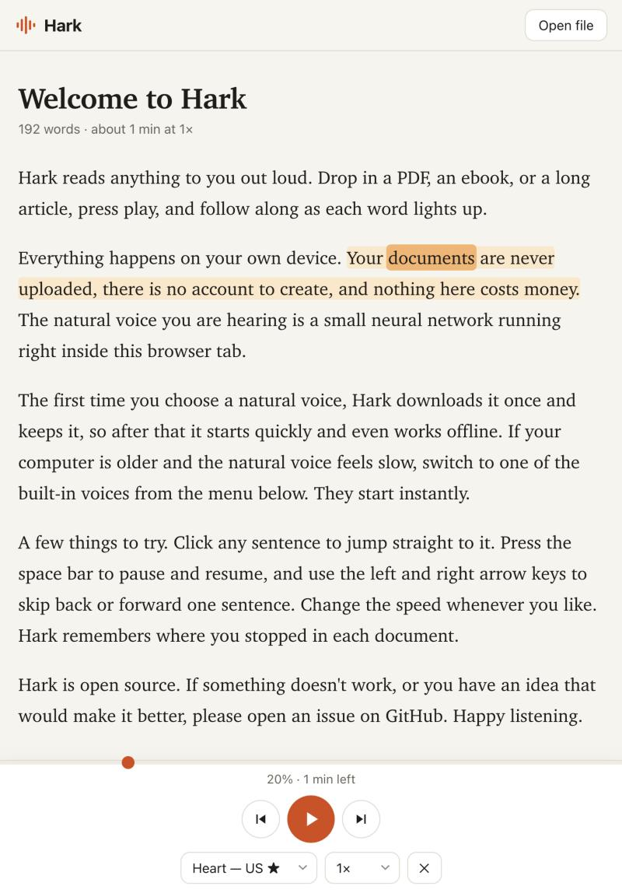

<div align="center">

# Hark

**Listen to any PDF, ebook or article with natural voices — free, private, and entirely in your browser.**

An open-source alternative to paid read-aloud apps. No account. No subscription. Your files never leave your device.

[**▶ Open Hark**](https://blop77.github.io/hark/) · [Report a bug](../../issues) · [Request a feature](../../issues)



</div>

## Why

Read-aloud apps are great for studying, for dyslexia and ADHD, for resting your eyes, and for getting through reading while you walk or cook. The good ones cost around $100+ a year and upload your documents to their servers.

Open-source neural voices are now good enough to run on an ordinary laptop, inside a browser tab. Hark puts one behind a simple reader.

## Features

- 📄 **Opens PDF, EPUB, TXT, Markdown and HTML.** Drag a file in, click to choose one, or just paste text anywhere on the page.
- 🗣️ **Natural neural voices** ([Kokoro-82M](https://huggingface.co/hexgrad/Kokoro-82M)) that run locally with WebGPU, or WebAssembly when there's no GPU. They're downloaded once, then work offline.
- ⚡ **Built-in system voices** as an instant, zero-download option.
- ✨ **Read-along highlighting** of the current sentence and word.
- 👆 **Click any sentence to jump there.** Space to pause, ← → to skip.
- 🐢🐇 **0.75× to 3× speed.**
- 💾 **Remembers where you stopped** in each document.
- 🎧 **Save the whole document as an audio file** (WAV) to listen anywhere.
- 🔒 **Private by design.** No server, no analytics, no account. Your documents stay on your device.
- 🧹 **Cleans up PDFs**: drops page numbers and running headers, rejoins hyphenated words and wrapped lines.

## Use it

Open **https://blop77.github.io/hark/** in Chrome, Edge, or another browser with WebGPU for the fastest natural voices. It also works in Firefox and Safari, using WebAssembly, which is slower.

The first time you press play with a natural voice, Hark downloads the voice model (about 90–330 MB depending on your device) and keeps it in the browser cache.

## Run it locally

```bash
git clone https://github.com/Blop77/hark.git
cd hark
npm install
npm run dev
```

```bash
npm test        # unit tests
npm run build   # production build in dist/
```

## How it works

| Piece | What it does |
| --- | --- |
| [`src/lib/pdf.ts`](src/lib/pdf.ts) | Extracts text with pdf.js, rebuilds lines and paragraphs, strips headers, footers and page numbers |
| [`src/lib/epub.ts`](src/lib/epub.ts) | Reads the EPUB spine in order and pulls readable blocks out of each chapter |
| [`src/lib/segment.ts`](src/lib/segment.ts) | Splits text into sentences (aware of abbreviations) and words, and chunks very long sentences |
| [`src/tts/kokoro.worker.ts`](src/tts/kokoro.worker.ts) | Runs Kokoro in a Web Worker (WebGPU first, then WASM) so the page never freezes |
| [`src/tts/kokoro.ts`](src/tts/kokoro.ts) | Prefetches upcoming sentences, plays audio, and drives word highlighting |
| [`src/lib/timing.ts`](src/lib/timing.ts) | Estimates word timings, since neural voices don't report them |
| [`src/player.ts`](src/player.ts) | Steps through sentences and handles play, pause, seek, speed and voice changes |

There's no backend. The production build is a static site that runs on GitHub Pages.

## Roadmap

- [ ] OCR for scanned PDFs
- [ ] Open web pages by URL (needs a browser extension to get around CORS)
- [ ] Chrome extension: read the current page
- [ ] MP3 / M4B audiobook export with chapters
- [ ] More languages (Kokoro supports Spanish, French, Hindi, Italian, Japanese, Portuguese and Chinese)
- [ ] Desktop app
- [ ] Dyslexia-friendly fonts and themes

Want one of these? 👍 the issue, or send a pull request.

## Contributing

Issues and pull requests are welcome. Run `npm test` before you open a PR. If a PDF or EPUB doesn't read correctly, please attach a sample (or describe its layout) in an issue. Those reports help the most.

## Credits

- [Kokoro-82M](https://huggingface.co/hexgrad/Kokoro-82M) by hexgrad (Apache 2.0) and [kokoro-js](https://www.npmjs.com/package/kokoro-js)
- [Transformers.js](https://github.com/huggingface/transformers.js) and [ONNX Runtime Web](https://onnxruntime.ai/)
- [pdf.js](https://github.com/mozilla/pdf.js) by Mozilla
- [JSZip](https://stuk.github.io/jszip/)

## License

[MIT](LICENSE)
